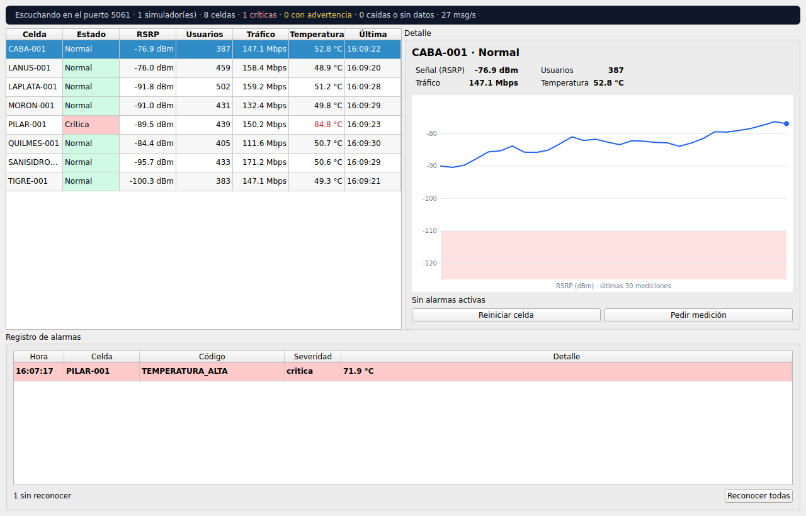
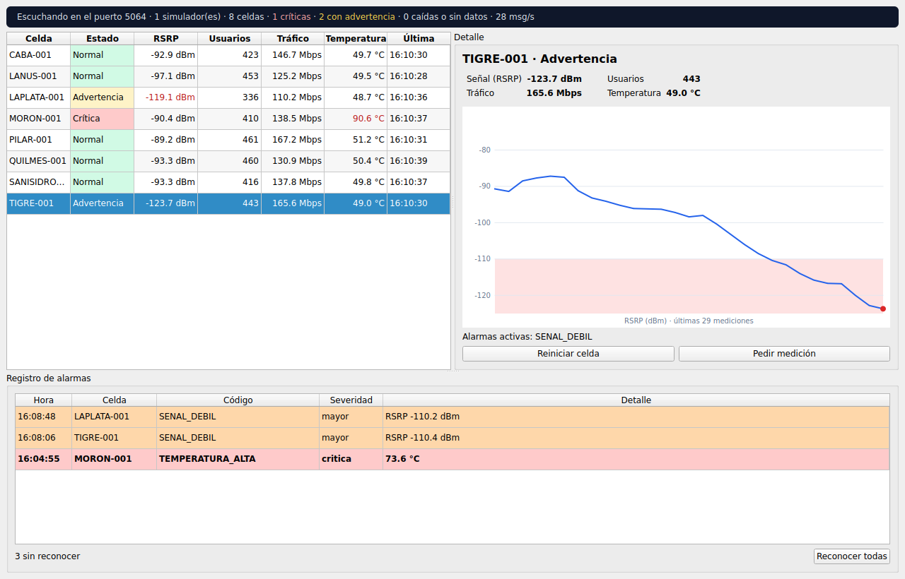

# Centro de monitoreo de antenas (C++ / Qt)

[English version](README.en.md)

Aplicación de escritorio que recibe por **TCP** la telemetría de las antenas y la muestra en vivo: estado de cada celda, gráfico de señal, registro de alarmas y botones para mandar comandos. Hecha en **C++17 con Qt 6** (Widgets, Network y Test) y **CMake**.

Recibe los datos del [simulador en Python](../simulador-antenas/) con un [protocolo](../PROTOCOLO.md) compartido. Es parte de un [conjunto de proyectos de telecomunicaciones](../README.md).



## Qué muestra
- **Servidor TCP multihilo:** cada simulador que se conecta tiene su propio `QThread`. El socket se crea dentro de ese hilo y los mensajes viajan al hilo de la interfaz con señales y slots encolados, sin compartir memoria a mano.
- **Sockets:** armado de líneas desde el flujo TCP (mensajes partidos o pegados), límite de 4096 bytes por línea, descarte de basura sin cortar la conexión y comandos en sentido contrario (`reiniciar`, `estado`) que se envían al simulador que maneja esa celda.
- **Interfaz con Qt (UI/UX):** modelos propios (`QAbstractTableModel`) para celdas y alarmas, colores por estado, gráfico de RSRP dibujado con `QPainter`, resumen arriba y alarmas sin reconocer en negrita.
- **Lógica de negocio separada de la vista:** el modelo no sabe nada de la red ni de la ventana, por eso se prueba solo.
- **Detección de silencios:** si una celda deja de transmitir 5 segundos pasa a "Sin datos", aunque el simulador no avise.
- **Pruebas con QtTest:** 18 casos, incluido uno que levanta el servidor real y conecta dos clientes por TCP.



## Cómo compilar y usar
Requiere Qt 6 (en Ubuntu/Debian: `sudo apt install qt6-base-dev cmake g++`).
```bash
cmake -S . -B build -DCMAKE_BUILD_TYPE=Release
cmake --build build -j

# Terminal 1: el monitor escucha en el puerto 5050
./build/monitor-antenas --puerto 5050

# Terminal 2: el simulador (desde ../simulador-antenas)
python3 -m simulador --celdas 8 --intervalo 1 --puerto 5050
```
Al elegir una celda se ven sus valores y el gráfico. "Reiniciar celda" la apaga unos segundos: se abre la alarma `ENLACE_CAIDO` y después llega `ENLACE_RESTABLECIDO`.

Las capturas de este README se generaron con `--captura archivo.png --seleccionar TIGRE-001`, que guarda la ventana y cierra (sirve sin pantalla con `xvfb-run`).

## Estructura
```
src/
  protocolo.*        Valida y arma los mensajes JSON (mismo protocolo que el simulador)
  lectorlineas.*     Arma líneas completas desde el flujo TCP
  modelored.*        Estado de la red: celdas, historial, alarmas abiertas y cerradas
  conexioncliente.*  Un cliente TCP, vive en su propio hilo
  servidortcp.*      QTcpServer: un hilo por cliente y ruteo de comandos por celda
  grafico.*          Gráfico de RSRP con QPainter
  ventana.*          Ventana principal
  main.cpp           Opciones de línea de comandos
tests/test_monitor.cpp  Pruebas con QtTest
```

## Pruebas
```bash
ctest --test-dir build --output-on-failure
# o directamente
QT_QPA_PLATFORM=offscreen ./build/pruebas
```
Cubren el protocolo (con casos inválidos), el armado de líneas, el orden de las celdas, alarmas que se abren y se cierran, enlace caído, celdas silenciosas, el límite del historial y una prueba real por TCP con dos clientes, un mensaje partido, basura y el envío de un comando al cliente correcto.

## Decisiones
| Decisión | Por qué |
|---|---|
| Un hilo por cliente con `moveToThread` | Si un simulador manda mucho o se traba, no congela la ventana ni a los demás clientes. Es el patrón que recomienda Qt (en vez de heredar `QThread`). |
| El socket se crea en `iniciar()` y no en el constructor | Un objeto de Qt pertenece al hilo donde se crea; si el socket naciera en el hilo principal, se usaría desde otro hilo y Qt lo prohíbe. |
| Comandos con `QMetaObject::invokeMethod` encolado | Escribir en el socket desde el hilo de la interfaz no es seguro; así la escritura corre en el hilo dueño del socket. |
| Gráfico con `QPainter` y no Qt Charts | Menos dependencias para compilar y control total del dibujo (la franja roja de señal débil). |
| El modelo recibe un reloj inyectable | Las pruebas de celdas silenciosas no tienen que esperar 5 segundos reales. |
